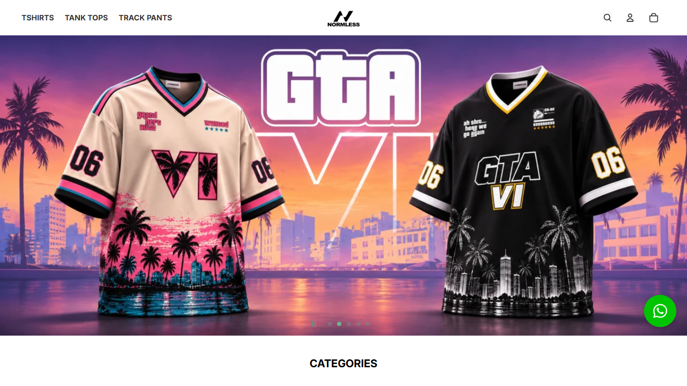
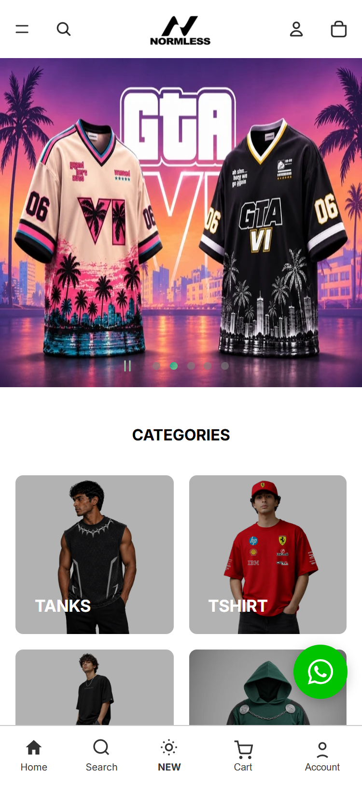
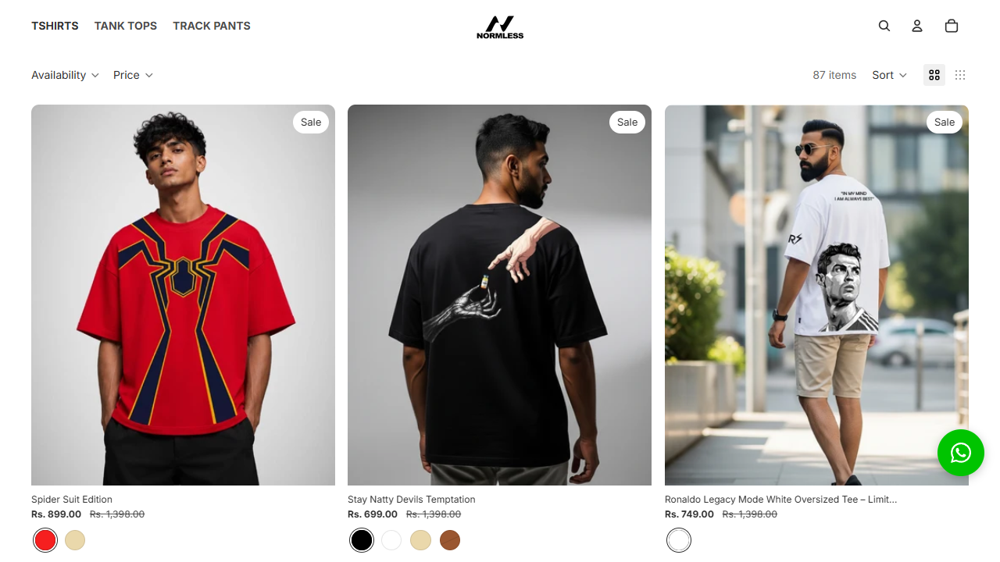
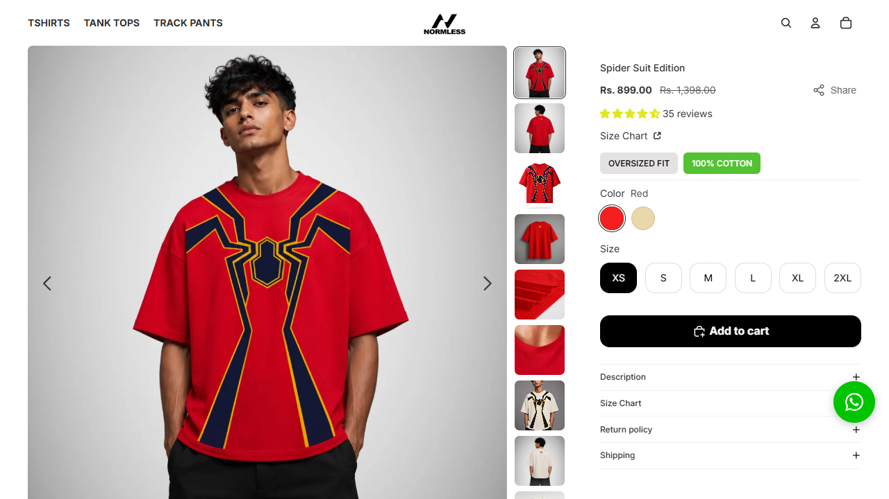
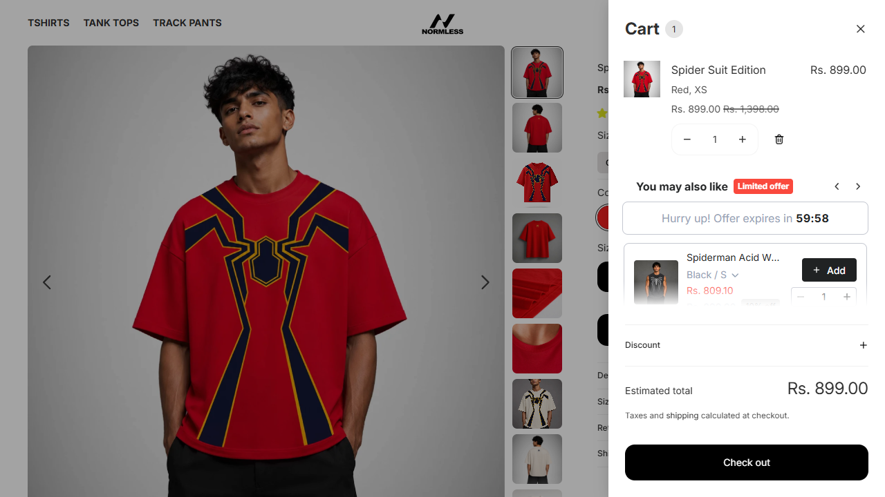
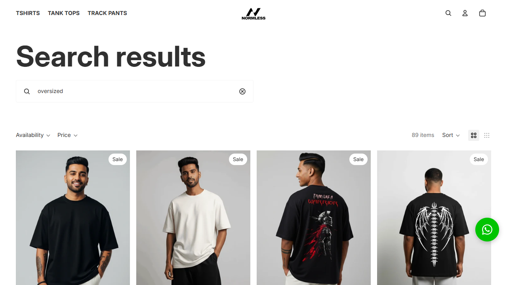
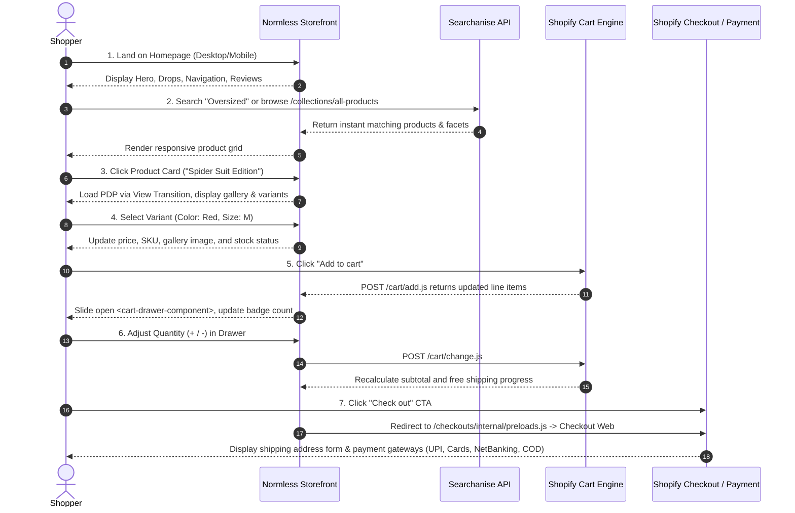

# In-Depth Reverse Engineering Report: Normless Store (`https://normless.store/`)

**Target:** `https://normless.store/`  
**Investigation Framework:** Reverse Engineer Anything (REA)  
**Evidence Artifacts:** Browser Scenario Captures (`ev_7bbabbe...`, `ev_0735f44...`), DOM Exports, Captured Screenshots, Runtime Traces  
**Local Timestamp:** 2026-11-17

---

## Executive Summary

Normless is an Indian direct-to-consumer (D2C) streetwear brand positioned around an unapologetic, youth-oriented aesthetic ("Bold Streetwear for the Limitless"). The storefront operates on **Shopify** utilizing the modern **Horizon v2.1.6 Live** theme (Theme Store ID: `2481`, Theme ID: `155697185012`). 

The technical architecture combines Shopify's modern Liquid section architecture with custom Web Components (`<cart-drawer-component>`, `<quantity-selector-component>`, `<cart-icon>`), native **View Transitions API** support, and high-performance client-side micro-interactions (AJAX Add to Cart, sticky buy modules, dynamic variant pickers). Search and discovery are delegated to **Searchanise** (`searchserverapi1.com`), customer reviews to **Judge.me**, and promotional social proof to **ToastiBar** (MakeProSimp).

---

## 1. Visual Design & Aesthetic Analysis

### 1.1 Aesthetic & Design Language
- **Category:** Modern Urban Streetwear / High-Contrast Brutalist Minimalist.
- **Visual Mood:** Bold, clean, stark monochromatic base with high-saturation graphic apparel artwork. The design emphasizes edge-to-edge product photography, bold typographic titles, and minimal superfluous decoration.
- **Grid & Alignment:** Strictly structured grid system with edge-to-edge full-bleed hero banners, structured 2-column to 4-column product matrices, and spacious content grouping.

```
┌────────────────────────────────────────────────────────────────────────┐
│ Announcement Bar: Offers / Free Delivery Announcement                  │
├────────────────────────────────────────────────────────────────────────┤
│ Header: [Logo]         [Tshirts | Tanks | Joggers | Hoodies]  [Search] │
├────────────────────────────────────────────────────────────────────────┤
│ Hero Banner: High-impact streetwear visual + CTA ("Shop Now")          │
├────────────────────────────────────────────────────────────────────────┤
│ Category Carousel: Tanks, Tshirts, Joggers, Hoodies                    │
├────────────────────────────────────────────────────────────────────────┤
│ Featured Drop 1 (e.g., GTA 6 Edition / Trending Streetwear)            │
│ ┌──────────────┐  ┌──────────────┐  ┌──────────────┐  ┌──────────────┐ │
│ │ Product Card │  │ Product Card │  │ Product Card │  │ Product Card │ │
│ └──────────────┘  └──────────────┘  └──────────────┘  └──────────────┘ │
├────────────────────────────────────────────────────────────────────────┤
│ Value Propositions: 100% Cotton, Heavyweight GSM, Pan-India Shipping   │
├────────────────────────────────────────────────────────────────────────┤
│ Footer: Brand Mission, Quick Links, Policies, Social, Newsletter       │
└────────────────────────────────────────────────────────────────────────┘
```

### 1.2 Desktop Visual Presentation


### 1.3 Mobile Visual Presentation


### 1.4 Typography System (Verified via CSS Variables)
Extracted directly from `:root` CSS declarations:

| Token / Role | Family | Weight | Size / Rule |
| :--- | :--- | :--- | :--- |
| **Primary Headings (`--font-heading--family`)** | `Inter, sans-serif` | `700` (Bold) | Fluid clamp: `clamp(2.25rem, 7.2vw, 4.5rem)` for H1 |
| **Body & Paragraphs (`--font-body--family`)** | `Inter, sans-serif` | `400` (Regular) | `0.875rem` (14px) / `1rem` (16px) |
| **Subheadings (`--font-subheading--family`)** | `Inter, sans-serif` | `500` (Medium) | `0.875rem` to `1.25rem` |
| **Accent / Display (`--font-accent--family`)** | `"Bricolage Grotesque", sans-serif` | `700` (Bold) | Used for promotional callouts, discount tags, badge typography |
| **H2 Headings (`--font-size--h2`)** | `Inter, sans-serif` | `700` | `2.0rem` (32px) |
| **H3 Headings (`--font-size--h3`)** | `Inter, sans-serif` | `700` | `1.5rem` (24px) |
| **Small / Badges (`--font-size--h6`)** | `Inter, sans-serif` | `500` | `0.75rem` (12px) |

### 1.5 Color Palette (Verified Tokens)
- **Primary Background:** Pure White `#FFFFFF` (`rgba(255 255 255 / 1.0)`)
- **Primary Foreground / Text:** Deep Black `#000000` (`rgba(0 0 0 / 1.0)`)
- **Secondary Surfaces & Hover:** Off-white `#F5F5F5` (`rgba(245 245 245 / 1.0)`) and `#FAFAFA`
- **Subtle Borders:** Translucent neutral gray (`rgba(0 0 0 / 0.1)`)
- **Discount & Sale Accents:** Contrasting dark pill badges with discount percentage indicators (`(35% OFF)`, `(43% OFF)`)
- **Out of Stock Indicator:** `#C8C8C8`

### 1.6 Spacing & Grid System
- **Page Container Width:** Default wide page max width `--wide-page-width: 150rem` (2400px), standard content width `--normal-content-width: 42rem`.
- **Drawer Widths:** Mobile drawer occupies `--drawer-width: 95vw`; desktop drawer scales to fixed `25rem` (400px) sidebar overlay.
- **Button & Input Heights:** Standardized 44px–48px touch targets, `--checkout-button-gap: 8px`.

---

## 2. Storefront Pages Breakdown

### 2.1 Homepage (`/`)
- **Top Announcement Bar:** Sticky notification banner communicating delivery thresholds and ongoing sales promotions.
- **Main Header:** Minimalist layout featuring the brand wordmark "NORMLESS®", primary collection navigation links (`Tshirts`, `Tank Tops`, `Track Pants`, `Hoodies`), search launcher, account access, and real-time cart bubble.
- **Hero Display Section:** High-resolution lifestyle imagery showcasing active drop collections.
- **Curated Category Grid:** Visual cards linking directly to dedicated sub-catalogs.
- **Product Highlights:** Grids of popular editions (e.g. "GTA 6 Wanted Edition", "Spider Suit Edition", "Acid Wash Relaxed Baggy Pants"). Each card features dual imagery (primary + hover alternate angle), price comparison (`Rs. 1,299.00` vs `Rs. 2,299.00`), discount percentage, and an inline Quick Add trigger.
- **Value Proposition Bar:** Trust badges highlighting fabric specifications (e.g., 240+ GSM French Terry, 100% Combed Cotton, Pre-shrunk).
- **Social Proof / Customer Reviews:** Embedded widget from Judge.me displaying verified buyer feedback and star ratings.

### 2.2 Collection & Product Listing Pages (PLP)
*Target URL:* `/collections/all-products`  


- **Grid Density:** Responsive 4-column layout on large viewports (>=1200px), 3-column on tablet (768px–1024px), and 2-column on mobile (<768px).
- **Product Card Architecture:**
  - Image ratio: 1:1 square ratio (`3240x3240` source previews).
  - Hover state: Instant image transition to alternate view (back graphic or model pose).
  - Price display: Current price bolded, compare-at price struck through, and percentage savings highlighted in colored text.
  - Interactive Quick Add (`quick-add.js`): Allows customers to select sizes and add to cart without navigating away from the grid.
- **Filtering & Facets:** Dynamic facet navigation allowing filtering by Size, Color/Wash, Product Type, and Price range, powered by Searchanise.

### 2.3 Individual Product Detail Page (PDP)
*Target URL:* `/products/spider-suit-edition`  


- **Gallery Structure:** Vertical multi-image thumbnail column on desktop with high-resolution main viewport; swipeable mobile image carousel on mobile devices.
- **Title & Pricing Block:**
  - Title: Product title with edition badge.
  - Pricing: Live price update responding to variant selection (`Rs. 899.00` with compare-at `Rs. 1,398.00`).
  - Tax & Shipping Notice: "Tax included. Shipping calculated at checkout."
- **Variant Selector (`variant-picker.js`):**
  - **Color Picker:** Visual swatch buttons (e.g., Red, Beige) mapped to variant image IDs.
  - **Size Pills:** Radio inputs styled as rectangular pill buttons (`XS`, `S`, `M`, `L`, `XL`, `2XL`). Sold out sizes are dynamically disabled with slash overlays.
- **Action CTAs:**
  - Primary button: `#BuyButtons-ProductSubmitButton-...__add-to-cart` (`Add to cart`).
  - Sticky bottom action bar (`floating-panel.js`): When scrolling past the main fold, a sticky bottom bar persists on mobile/desktop containing the product thumbnail, variant summary, and "Add to Cart" button.
- **Collapsible Information Sections (`accordion-custom.js`):**
  - Product Description & Fit Notes.
  - Size Chart / Measurements table modal.
  - Fabric & Care Instructions (Wash inside out, cold wash, do not iron on print).
  - Shipping & Returns policy summary.

### 2.4 Cart Drawer (`<cart-drawer-component>`)
*Target Trigger:* AJAX submission on Product Page or Header Cart click.  


- **Presentation:** High-performance `<dialog>` element configured with `scroll-lock=""` that slides out from the right viewport edge.
- **Components:**
  - Header with item count and close (`X`) button.
  - Free Shipping Threshold indicator (e.g., "Add Rs. XXX more for Free Shipping").
  - Item Rows: Product thumbnail, title, selected variant (e.g. "Red / XS"), unit price, and `<quantity-selector-component>` (`-`, `1`, `+`).
  - Cross-sell / Upsell recommendations: Powered by **Essential Upsell** module displaying complementary products.
  - Subtotal & Discount block: Displays pre-checkout totals and accepted payment badge icons.
  - Primary CTA: Full-width `<button id="checkout" name="checkout">Check out</button>`.

### 2.5 Search Experience
*Target URL:* `/search?q=oversized`  


- **Integration:** Powered by **Searchanise** (`searchserverapi1.com`).
- **Instant Overlay:** Typing in the header input triggers an instant autocomplete dropdown showing trending search terms, product thumbnail suggestions, and direct collection shortcuts.
- **Full Search Results Page:** Renders a filtered catalog matching query tokens with instant facet filtering without full-page reloads.

---

## 3. Interaction & Animation Documentation

| Interaction / Feature | Observed Mechanism | Underlying Implementation |
| :--- | :--- | :--- |
| **Page Navigation Transitions** | Seamless cross-fade without white flash during route transitions | Native **View Transitions API** via `view-transitions.js` |
| **Image Hover Flip** | Hovering over product card smoothly reveals back graphic | CSS transition on secondary image opacity (`transition: opacity 0.3s ease`) |
| **Variant Switching** | Clicking size/color pills dynamically alters URL (`?variant=...`), updates stock status, and switches main gallery image | `variant-picker.js` using Shopify Storefront Section Rendering API |
| **Add to Cart** | Button shows loading state; drawer slides in from right; cart count badge animates | AJAX `POST /cart/add.js`, `<cart-drawer-component>` open event |
| **Sticky Purchase Bar** | Scrolling past main form triggers fixed bottom toolbar | IntersectionObserver observing form viewport boundaries (`floating-panel.js`) |
| **Accordion Dropdowns** | Smooth expand/collapse on description and shipping tabs | Native `<details>` / `<summary>` wrapped in custom JS accordion handlers |
| **Mobile Drawer Menu** | Hamburger click smoothly slides full-height navigation overlay with sub-menus | Custom mobile drawer component with CSS `transform: translateX` |

---

## 4. Complete Customer Shopping Journey



1. **Discovery & Exploration:** The shopper lands on the homepage or specific social ad drop landing page. Visual banners and collection links direct them to specific drops (e.g. GTA 6 Edition, Spiderman Acid Wash, Oversized Tees).
2. **Product Evaluation:** Shopper reviews high-resolution model imagery, size charts, GSM fabric specifications, and customer photo reviews via Judge.me.
3. **Variant Selection:** Shopper selects preferred color and size. Visual feedback immediately validates inventory availability.
4. **Cart Addition:** Clicking "Add to cart" triggers an asynchronous AJAX request that opens the cart drawer without disturbing shopping momentum.
5. **Upsell Engagement:** Inside the drawer, the customer is exposed to complementary items (socks, cargo pants, acid wash caps) and a free shipping progress bar.
6. **Checkout Transfer:** Clicking "Check out" transfers session state seamlessly into Shopify's hardened PCI-compliant checkout infrastructure.
7. **Payment & Order Confirmation:** Indian payment methods (UPI apps: GPay, PhonePe, Paytm; Net Banking; Credit/Debit cards; Cash on Delivery) are handled through authorized payment aggregators before dispatching order confirmation emails/SMS.

---

## 5. Technical Architecture & Verified Stack

| Layer | Verified Technology | Technical Evidence |
| :--- | :--- | :--- |
| **E-Commerce Platform** | Shopify Plus / Core | Server header `powered-by: Shopify`, Cookie `_shopify_essential` |
| **Storefront Theme** | **Horizon v2.1.6 Live** | `Shopify.theme = {"name":"Horizon v2.1.6 Live","id":155697185012,...}` |
| **CDN & Edge Caching** | Cloudflare CDN | `Server: cloudflare`, `cf-cache-status: DYNAMIC`, `CF-RAY` |
| **Search Engine** | Searchanise | External scripts `//searchserverapi1.com/widgets/shopify/init.js` |
| **Customer Reviews** | Judge.me Product Reviews | Assets `cdn.shopify.com/.../judgeme-861/assets/shopify_v2.css` |
| **Social Proof / Notifications** | ToastiBar (MakeProSimp) | Script `toastibar-cdn.makeprosimp.com/.../app.js` |
| **In-Cart Upsells** | Essential Upsell | Elements with attribute `data-essential-upsell-element` |
| **Analytics & Attribution** | Meta Pixel & Google Tag Manager | Pixel ID `1064112352528860`, GTM container `G-JC81SV6DGE` |
| **Page Transitions** | View Transitions API | Preloaded asset `view-transitions.js?v=132588197357770770831761652037` |
| **Web Components** | Custom Elements V1 | `<cart-drawer-component>`, `<quantity-selector-component>`, `<cart-icon>` |

---

## 6. Verification Boundaries, Limitations & Unknowns

In accordance with REA investigative methodology, observed facts are strictly distinguished from unverified assumptions:

- **Verified Facts:**
  - Theme identity, version, and schema parameters.
  - Active third-party app scripts and stylesheet origins.
  - DOM structure, Web Component definitions, and form submit handlers.
  - Exact CSS typography variables, color tokens, and layout breakpoints.
  - Cart drawer slideout behavior and AJAX payload endpoints.
- **Unverified / Unknown Boundaries:**
  - **Backend Inventory Levels:** Live warehouse stock counts are masked behind Shopify's inventory API.
  - **Payment Gateway Settlement:** Specific payment provider commission rates and merchant banking credentials cannot be inspected from frontend storefront observation.
  - **Manufacturing Supply Chain:** Fabric GSM claims (e.g. "240 GSM") are marketing specifications on the PDP and were not physically lab-tested.
  - **Shopify Flow Automations:** Internal CRM automations, abandoned cart email sequences, and fulfillment rules reside entirely within private merchant admin servers.

---

## 7. Key Takeaways for Future Project Reference

1. **Keep the Core Monochromatic:** A clean black-and-white theme layout (`#FFFFFF` background, `#000000` text and borders) provides maximum visual contrast for vibrant graphic streetwear designs.
2. **Prioritize Native View Transitions:** Integrating `view-transitions.js` creates a native mobile app feel when transitioning between collection listings and individual product pages.
3. **Cart Drawer Over Dedicated Cart Page:** The slideout `<cart-drawer-component>` keeps the customer in context while immediately surfacing upsell opportunities and free-shipping thresholds.
4. **Persistent Sticky Purchase Bar:** Implementing an `IntersectionObserver`-based sticky bar on mobile PDPs reduces friction for impulsive checkouts on long-scrolling product pages.
5. **Instant Headless Search:** Offloading autocomplete and catalog search to a dedicated index service (like Searchanise) keeps page loads lightweight while delivering sub-100ms search results.
